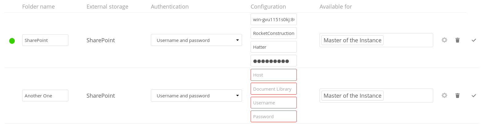

<!--
  - SPDX-FileCopyrightText: 2017 Nextcloud GmbH and Nextcloud contributors
  - SPDX-License-Identifier: AGPL-3.0-or-later
-->
# SharePoint

💾 Nextcloud SharePoint Backend for External storages

The SharePoint Backend allows administrators to add SharePoint document libraries as folders in Nextcloud. This offers an easy way for users to access SharePoint data in the same place where they find their other files, facilitating collaboration and sharing within and across the borders of the organization. Users can use the desktop client, mobile apps or web interface and comment, tag, share and collaboratively edit files on SharePoint just like with any other data on Nextcloud.

* Supports SharePoint 2013, 2016, 2019 (experimental) and SharePoint Online (Office 365).
* Nextcloud accesses SharePoint through the SharePoint REST API and uses SAML Token authentication, with a fallback to NTLM auth.
* Nextcloud respects file access permissions associated with its configured user credentials.
* Versioning and sharing are handled by Nextcloud.

Learn more about External Storage and SharePoint on [https://nextcloud.com/storage/](https://nextcloud.com/storage/).

# How To Add Office 365 Onedrive

1. Enable the *[External storage support](https://docs.nextcloud.com/server/stable/go.php?to=admin-external-storage)* app.
2. Install/enable the *Sharepoint Backend* app (this app).
3. Get your remote's URL:
    1. Go [here](https://onedrive.live.com/about/en-us/signin/) to open your OneDrive or to sign in.
    2. Look at your address bar. For a URL like `https://contoso-my.sharepoint.com/personal/user_contoso_com/_layouts/15/onedrive.aspx`, copy the personal-site portion: `https://contoso-my.sharepoint.com/personal/user_contoso_com`. Use the actual URL shown for your account.
4. In Nextcloud, go to *Administration Settings* and select *External Storage*.
5. Add a *Sharepoint* storage.
6. Enter the personal-site URL in the *Host* field. Do not append `/Documents`.
7. Enter `Documents` in the *Document Library* field, or use the actual library title if different.
8. Enter your email as *Username* and enter your *password* and you are good to go. (Note: If you have 2FA enabled, you have to generate an app password within your Sharepoint account).

Credit goes to [rclone](https://rclone.org/webdav/#sharepoint-online).
